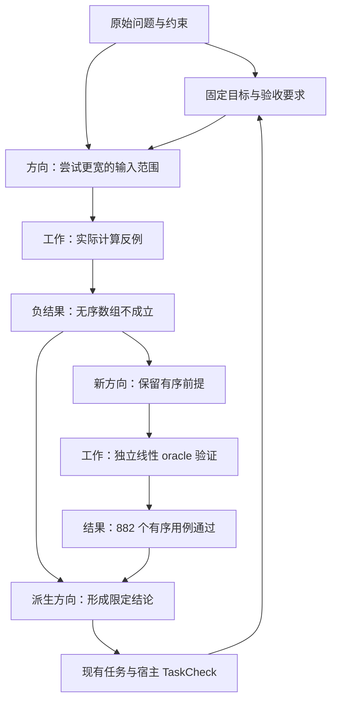

# 探索图与通用探索 Skill

探索图已实现为内置 `skill:super-agent/research/exploration`。它把目标、探索方向、工作尝试、结果及派生方向串成一张图，保留失败与不确定结果，支持多来源谱系、前沿查询、预算停止、Mermaid 导出和显式检查点恢复。它负责研究过程的记录与约束；执行继续走唯一 Runtime，任务流转与验收继续由现有 TaskQueue/TaskCheck 负责。

这是借鉴 ARTEX 通用设计的独立实现，适用于一般研究、算法和离线量化，不包含攻击、渗透或交易执行功能。没有新增默认依赖、图数据库、后台规划器或持久记忆。

## 使用入口

```bash
super-agent --skill skill:super-agent/research/exploration "研究这个问题，保留失败方向与证据，并输出探索图"
super-agent --skill skill:super-agent/research/algorithms "验证这个算法，按反例调整探索方向"
super-agent --skill skill:super-agent/research/quantitative "比较离线策略，保留因果检查、成本与失败候选"
```

内置 Skill 激活后，宿主提供 `exploration_update` 与 `exploration_read`。默认每次运行拥有一张独立图，最多开始 24 次工作、保存 192 个节点；模型只能降低预算。图工具只记录研究过程，代码、文件、来源读取和实验执行仍使用已授权工具。预算单位是工作开始次数，估计 effort 只参与前沿排序；模型 token、实际时间、实验成本仍使用宿主原有约束。

默认 CLI 能记录探索、查看前沿和导出有界 Mermaid，但没有自动配置语义验收器和可信来源读取器，因此结果显示 `unverified`，目标不会自行显示已验收。要让图中的目标得到可信验收，由 Python 宿主注入下述已有队列和检查。另一宿主只加载 Skill 文本时，也须明确提供等价工具，文本本身不能注册能力。

## 图怎样推进



每个方向有目标引用、一个或多个来源父节点、假设、理由、优先级和估计工作量。首轮父节点为 `origin`，后续父节点为实际结果。前沿按优先级降序、工作量升序、ID 排序，保留所有候选；它为模型选择下一步提供依据，不宣称自动求得最优规划。新增结果、来源变化和任务事件后重新读取，`event_token` 能识别图版本未变但证据或任务状态已变化的情况。

`begin` 创建工作节点并消耗一步，不执行外部动作；每个方向只记录一次尝试，返工建立新方向，旧结果不覆盖。`positive`、`negative` 和 `inconclusive` 都是待核对的结果分类。可以把现有同作用域 TaskQueue 任务绑定到工作节点；图查询从队列读取任务状态，不复制或修改任务状态。任务没有确认终止时不能在图中报告完成或通过“放弃方向”伪造取消。

方向的 `basis=hypothesis` 允许调查未验证、争议或失效材料；`basis=evidence` 表示确实依赖父结果，父结果必须有当前关联。来源改版、删除、到期或绑定任务返工，会使相关结果及其依赖需要复核。反证仍被保留，不能通过丢掉反证使结论变可靠。

## 宿主接入与验收

```python
from super_agent.skill.exploration import ExplorationGraph
from super_agent.skill.exploration_tools import ExplorationTools
from super_agent.skill.organization_tasks import TaskQueue

queue = TaskQueue(scope="study")
graph = ExplorationGraph(
    "study", "原始问题与约束",
    [{"id": "answer", "statement": "交付限定范围内的结论", "acceptance": "独立检查与来源复核"}],
    tasks=queue,
    evidence=read_current_evidence,  # 宿主取得真实内容后构造 Evidence
    max_steps=12,
)
agent.add_tools_for_skills(ExplorationTools("study", graph=graph).tools())
result = agent.run("开展研究", skill="skill:super-agent/research/exploration")
```

宿主为已有任务登记 `TaskCheck`。在其 `snapshot()` 中合入 `graph.snapshot(result_ids)` 与产物哈希，在 `check()` 中运行独立的语义、算法或实验检查。快照覆盖选中结果、证据依赖祖先、方向定义和目标契约，不包含验收状态，不依赖不相关分支，避免“验收器检查自己的验收结果”的循环。图绑定执行任务时，会固定其 attempt 身份；队列返工或旧产物验收失效会让图中相关结果待复核。

宿主通过 `graph.bind_goal(goal_id, task_id, result_ids, expected_version=..., request_id=...)` 明确指定哪份结果和哪个检查任务用于该目标。目标只有在相关证据关联当前完整、指定任务的 TaskCheck 当前通过时才显示 `accepted`；所有方向已报告或明确放弃后，整图才显示 `completed`。旧绑定失效后宿主可带理由绑定返工结果，保留绑定历史；模型工具没有验收或重绑目标的操作。`linked` 仅证明声明的关系当前完整，错误结论也可能有完整关联，所以独立检查仍是必要条件。

未通过验收、空前沿、预算耗尽或显式停止时，都报告未完成目标和剩余工作。图停止不会取消外部进程或任务。团队、共享板和等待继续作为可选能力；没有队伍也可开展完整的单 Agent 实验。

## 查询、可视化与恢复

`exploration_read` 支持 `overview`、`frontier`、`nodes`、`node`、`mermaid`。分页默认 20、最多 50 项，保留真实总数与 `has_more`。Mermaid 页面只包含该页节点之间的边，并报告遗漏边数；完整导出使用宿主 `graph.mermaid()`。详细参数见 Skill 内的 [graph-protocol.md](../src/super_agent/skill/builtin/skills/super-agent/research/exploration/references/graph-protocol.md)。

图更新用 `expected_version` 防止并发旧计划覆盖新计划；同一 `request_id` 和相同内容只记一次，不同内容重用请求会失败。非法节点、悬空引用、错误状态和超预算操作不会部分提交。谱系按已有结果向新方向扩展，执行来源没有依赖环；结果到目标的验收边表达目标反馈，不是任务依赖。

`graph.checkpoint()` 返回 JSON，默认不写文件。宿主明确保存后，用 `ExplorationGraph.restore(checkpoint, scope=..., tasks=..., evidence=...)` 恢复。恢复检查结构、作用域和损坏，并重新读取当前证据与宿主检查；校验摘要不提供身份认证。运行中的工作进入 `interrupted`，阻止新执行，由宿主核对真实效果后调用 `reconcile`。恢复不会调用模型、执行器或重放外部动作。检查点也不保存队列的执行体；已有队列及 TaskCheck 必须由宿主按原恢复流程重新挂载。

## 与其他预设的合并

| 预设 | 复用探索图的部分 | 保留的专属职责 |
| --- | --- | --- |
| research | 目标、方向、谱系、再规划、停止 | 来源、引用、事实与结论审查 |
| algorithms | 同一探索 Skill + experiments | 输入契约、oracle、反例、正确性与复杂度 |
| quantitative | 同一探索 Skill + experiments | 因果时间、留出区间、费用、风险与数据版本 |
| deep-optimization | 同一探索 Skill + experiments | 代码行为、性能基线、工作负载与保护指标；团队及模型轮换改为按需 |
| task / team | 通过任务 ID 关联 | 唯一任务状态、依赖、执行、验收、等待与取消 |
| context-compression | 保留图中原始引用 | 显式压缩、中央资源回读；本批不增加自动冷图压缩 |

研究入口包含公共探索方法，算法和量化同时引用实验方法。深度优化移除强制嵌套团队与模型轮换，保留可选批次并行。激活包含关系会去重，共享工具和图只有一份；小任务无需为了使用研究方法创建一张图。

## 实际离线演示与验证边界

```bash
PYTHONPATH=src python3.11 examples/exploration_research.py --output /tmp/exploration-demo
```

[示例](../examples/exploration_research.py)实际计算 `[3, 1, 2]` 的无序输入反例，二分与线性结果分别为 `2` 和 `0`；再对有序数组、空输入、重复值和边界目标执行 882 个独立线性 oracle 用例。最后把正/负结果合成限定结论，经现有 TaskCheck 验收与交付，并恢复检查点后重新核对。完整[示例探索图](exploration-example.mmd)由该脚本生成。输出目录是显式选择的任务产物，不是自动持久记忆。

`MockModel` 只验证原生工具和 Skill 装配，算法检查在宿主真实执行。测试覆盖预算/空前沿、证据与任务失效、负结果、多父谱系、请求去重、并发、范围隔离、恢复和单 Agent 场景组合。它们不证明真实模型的方向选择质量、长任务成功率或实际投资效果。真实模型收益、图驱动自动压缩和后台恢复尚未验证，本批不声称支持。
